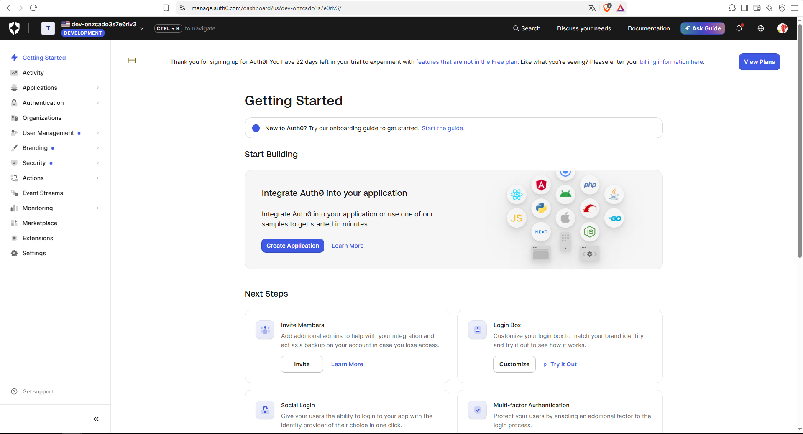
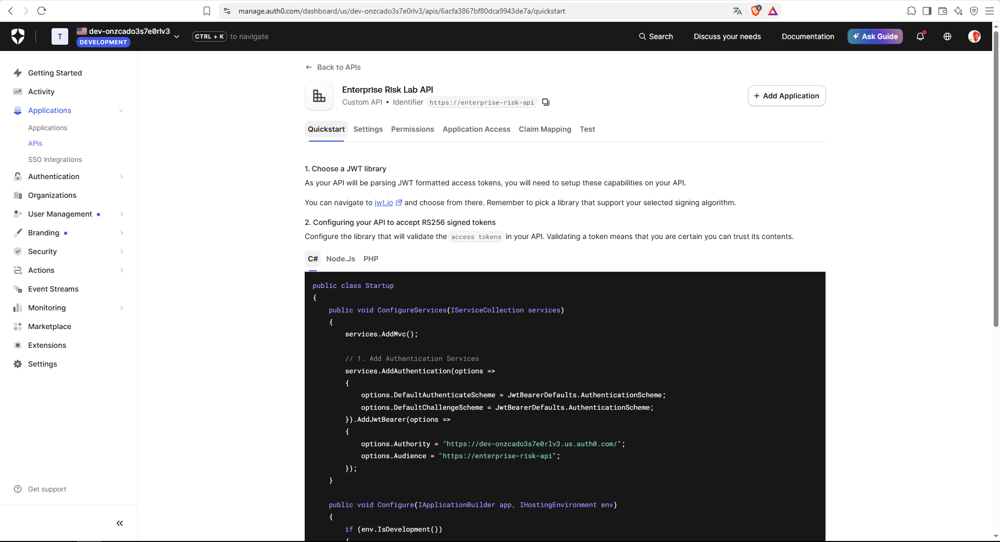
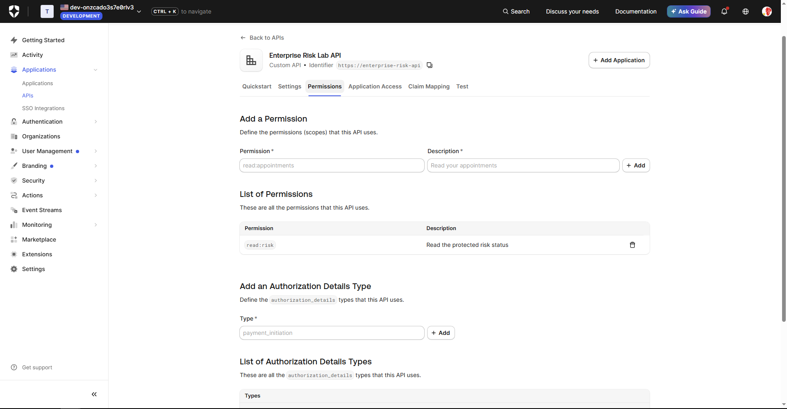
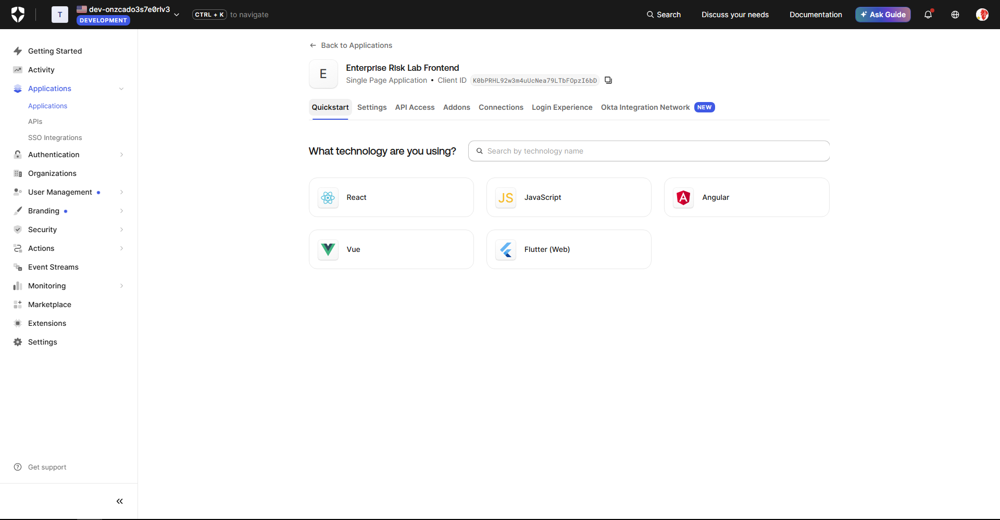
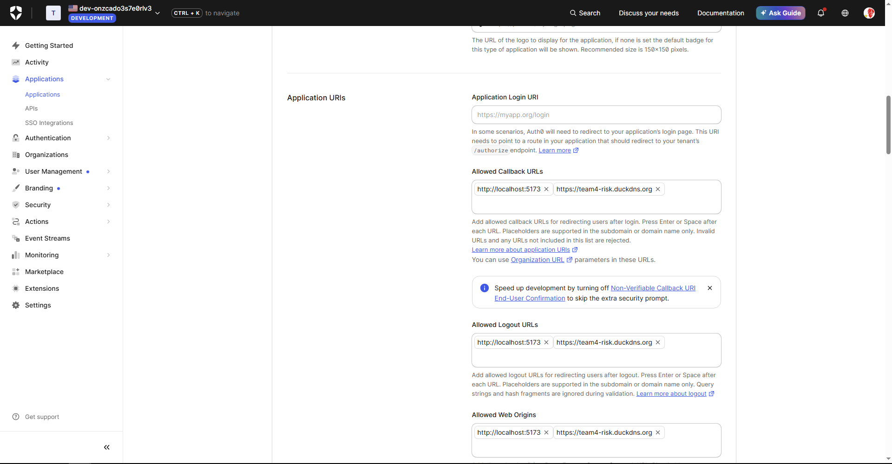
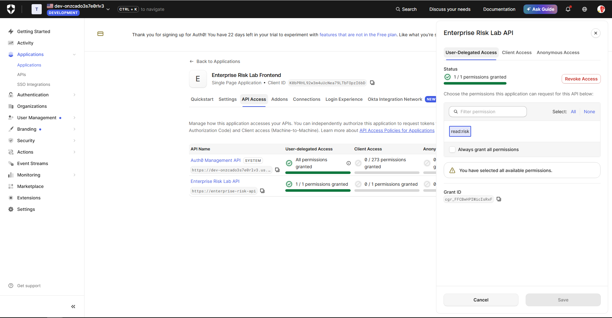
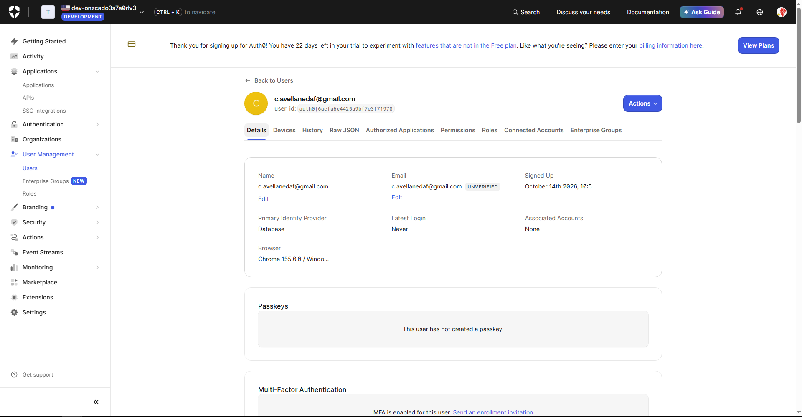

# Secure Web System as an Enterprise Risk Control

Sistema web pequeño que aplica controles de riesgo empresarial: un frontend React que autentica usuarios con **Auth0**, un backend **Spring Boot** protegido como **OAuth 2.0 Resource Server** (validación de JWT, issuer y audience) y un despliegue público con **HTTPS** (Duck DNS + Apache + Let's Encrypt) sobre AWS EC2 (Amazon Linux).

## URLs desplegadas

| | URL |
|---|---|
| HTTPS (principal) | **https://team4-risk.duckdns.org** |
| HTTP (redirige a HTTPS) | http://team4-risk.duckdns.org |
| Endpoint protegido | https://team4-risk.duckdns.org/api/risk-status |

## Entregables

| Entregable | Ubicación |
|---|---|
| Código fuente | [`frontend/`](frontend), [`backend/`](backend) |
| README con URL HTTPS | este archivo |
| Captura de llamada autenticada exitosa | [`evidencias/llamada-autenticada.png`](evidencias/llamada-autenticada.png) |
| Evidencia del certificado válido | [`evidencias/despliegue.txt`](evidencias/despliegue.txt) (`openssl s_client`, `certbot certificates`, `renew --dry-run`) |

## Arquitectura

```
Browser
  │ login y access token
  ▼
Auth0 ───────────────► React frontend ── Bearer token ──► Spring Boot API (127.0.0.1:8081)
                                                        │
Internet ── Duck DNS ── Apache + TLS (80/443) ──────────┘
```

- El navegador inicia sesión en Auth0 (Authorization Code + PKCE) y obtiene un access token con `audience=https://enterprise-risk-api`.
- El frontend llama a `/api/risk-status` con `Authorization: Bearer <token>`.
- Apache sirve el SPA y hace reverse proxy de `/api/` hacia el backend, que escucha solo en `127.0.0.1`.
- El backend valida firma (JWKS de Auth0), `iss` y `aud` de cada token.

## Estructura

```
backend/    Spring Boot 3.5 · Java 21 · Maven wrapper · Web, Security, OAuth2 Resource Server, Actuator
frontend/   Vite + React + @auth0/auth0-react
deploy/     systemd, virtual host de Apache y scripts de despliegue (Amazon Linux 2023)
capturas-auth0/  evidencia de la configuración de Auth0
```

## Parte 1 — Configuración de Auth0

| Valor | |
|---|---|
| `AUTH0_DOMAIN` | `dev-onzcado3s7e0rlv3.us.auth0.com` |
| `AUTH0_CLIENT_ID` | `K0bPRHL92w3m4uUcNea79LTbFOpzI6bD` (SPA, sin client secret) |
| `AUTH0_AUDIENCE` | `https://enterprise-risk-api` |

1. **Tenant** de desarrollo `dev-onzcado3s7e0rlv3`.

   

2. **API** `Enterprise Risk Lab API`, identifier `https://enterprise-risk-api`, firma RS256.

   

3. **Permiso** `read:risk` — *Read the protected risk status*.

   

4. **SPA** `Enterprise Risk Lab Frontend` (Single Page Application).

   

5. **URLs permitidas** (Callback, Logout y Web Origins): `http://localhost:5173` y `https://team4-risk.duckdns.org`, sin comodines.

   

6. **User-Delegated Access**: la SPA tiene concedido `read:risk` sobre la API (1/1 permisos). *Client Access* queda en 0 porque es para machine-to-machine, no para login en navegador.

   

7. **Usuario de prueba** en *Database → Users*.

   

## Parte 2 — Backend

- `SecurityConfig`: CSRF deshabilitado (API sin cookies), sesión `STATELESS`, CORS restringido a orígenes exactos y solo `GET`, `/actuator/health` público, `/api/**` autenticado, todo lo demás `denyAll`.
- `RiskController`: `GET /api/risk-status` devuelve el `sub` del JWT.
- Issuer, audience y CORS se leen de **variables de entorno** (`application.properties`):

| Variable | Default (desarrollo) |
|---|---|
| `AUTH0_ISSUER_URI` | `https://dev-onzcado3s7e0rlv3.us.auth0.com/` (con `/` final) |
| `AUTH0_AUDIENCE` | `https://enterprise-risk-api` |
| `CORS_ALLOWED_ORIGINS` | `http://localhost:5173,https://team4-risk.duckdns.org` |
| `SERVER_ADDRESS` / `SERVER_PORT` | `0.0.0.0` / `8080` (en producción `127.0.0.1` / `8081`) |

Ejecutar en local:

```powershell
cd backend
.\mvnw.cmd spring-boot:run
```

Verificación local (sin token responde **401**):

```
$ curl -i http://localhost:8080/api/risk-status
HTTP/1.1 401
WWW-Authenticate: Bearer

$ curl http://localhost:8080/actuator/health
{"status":"UP"}
```

Tests (`.\mvnw.cmd test`): 401 sin token, 200 con JWT, health público y rutas no declaradas denegadas.

## Parte 3 — Frontend

```powershell
cd frontend
npm install
npm run dev        # http://localhost:5173 (usa .env.local)
npm run build      # dist/ (usa .env.production)
```

- `.env.local` (no se versiona): `VITE_API_URL=http://localhost:8080`.
- `.env.production`: `VITE_API_URL=https://team4-risk.duckdns.org`. Solo contiene domain, client ID y audience, que son públicos en un SPA; **nunca** un client secret.
- `getAccessTokenSilently()` obtiene el token; la app no lo muestra ni lo guarda manualmente.

## Partes 4 a 6 — Despliegue en EC2 (Amazon Linux 2023)

Adaptación de la guía (Ubuntu) a Amazon Linux:

| Ubuntu (guía) | Amazon Linux 2023 |
|---|---|
| `apt install apache2` | `dnf install httpd mod_ssl` |
| `openjdk-21-jre` | `java-21-amazon-corretto-headless` |
| `a2enmod ssl proxy proxy_http rewrite headers` | ya cargados por `httpd`/`mod_ssl` |
| `/etc/apache2/sites-available/` + `a2ensite` | `/etc/httpd/conf.d/enterprise-risk.conf` |
| `systemctl reload apache2` | `systemctl reload httpd` |

**Security group de AWS**: entrada solo TCP 22 (SSH, idealmente restringido a tu IP), 80 y 443. Los puertos 8080 y 8081 **no** se abren; el backend escucha solo en `127.0.0.1:8081`.

Archivos en `deploy/`:

| Archivo | Uso |
|---|---|
| `deploy.ps1` | En Windows: compila backend y frontend, sube `app.jar`, `dist/` y los archivos de `deploy/` a `~/deploy` por `scp`. |
| `server-setup.sh` | Una sola vez: instala httpd, mod_ssl, Corretto 21 y certbot; crea el usuario de sistema `riskapi`. |
| `server-deploy.sh` | Cada despliegue: instala el JAR y el servicio systemd, copia el frontend a `/var/www/enterprise-risk-frontend`, instala el virtual host y recarga Apache. |
| `server-https.sh` | Certificado Let's Encrypt con `certbot --apache --redirect`, renovación automática y `certbot renew --dry-run`. |
| `enterprise-risk-api.service` | Servicio systemd con issuer/audience por variables de entorno, escucha en `127.0.0.1:8081`, endurecido (`NoNewPrivileges`, `ProtectSystem=strict`). |
| `enterprise-risk.conf` | Virtual host: SPA con rewrite a `index.html` y proxy `/api/` hacia `127.0.0.1:8081`. |

Secuencia:

```powershell
# 1. Windows: compilar y subir
.\deploy\deploy.ps1

# 2. Servidor: preparar (una vez), desplegar y emitir el certificado
ssh -i "C:\Llave.pem" ec2-user@3.85.202.14
sudo bash ~/deploy/server-setup.sh
sudo bash ~/deploy/server-deploy.sh
sudo bash ~/deploy/server-https.sh
```

Redespliegues posteriores: `.\deploy\deploy.ps1 -Install`. Si el certificado ya existe, `server-deploy.sh` conserva la redirección HTTP → HTTPS que agregó certbot.

Logs de auditoría del servicio: `sudo journalctl -u enterprise-risk-api`.

Notas del despliegue real:

- En la instancia corrían dos contenedores Docker de laboratorios anteriores (`webframework` en :80 y `virtualization-lab` en :8080, este último expuesto a Internet). Se detuvieron y se les quitó el reinicio automático (`docker update --restart=no`) para liberar el puerto 80 para Apache y cerrar el 8080. No se borraron: `sudo docker start webframework virtualization-lab`.
- Por eso el backend usa `127.0.0.1:8081` en producción, sin conflicto aunque esos contenedores vuelvan a arrancar.
- `mod_ssl` en Amazon Linux 2023 solo genera `localhost.crt` al primer arranque de httpd; `server-deploy.sh` lo crea antes de `apachectl configtest`.

## Reflexión de control de riesgos

| Control | Riesgo reducido | Evidencia |
|---|---|---|
| Autenticación con Auth0 | Suplantación y manejo débil de credenciales | Flujo de login de Auth0 e identidad del usuario |
| Validación de JWT en la API | Acceso no autorizado a la API | 401 sin token válido |
| Validación de audience | Reutilización de tokens contra otra API | La API solo acepta `aud=https://enterprise-risk-api` |
| HTTPS con certificado válido | Exposición de credenciales o tokens en tránsito | Detalles del certificado en el navegador |
| Reverse proxy Apache | Exposición directa del puerto de la aplicación | Solo 80 y 443 públicos; backend en `127.0.0.1` |
| Logs centralizados del servicio | Investigación tardía de incidentes | `journalctl -u enterprise-risk-api` |

## Notas de seguridad

- No se versionan `.env.local`, llaves `.pem`, credenciales del servidor, secretos de Auth0 ni tokens de Duck DNS (`.gitignore`).
- El SPA usa solo el client ID; nunca un client secret.
- CORS restringido a los orígenes exactos de desarrollo y producción.
- El backend corre con un usuario de sistema sin shell (`riskapi`), mínimo privilegio.
